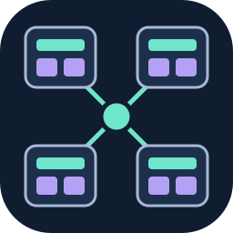
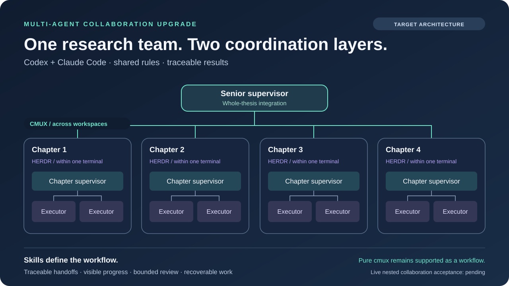

<p align="center"></p>

# Multi-Agent Collaboration Upgrade

[繁體中文](README.zh-TW.md) · [Agent quickstart](docs/agent-quickstart.md) · [Agent instructions](AGENTS.md)

Reusable collaboration rules, an offline dependency planner and experimental TASK runtime code for terminal-based agents. The goal is to combine **cmux for coordination across terminals and workspaces** with **Herdr for teamwork inside a terminal**, while keeping existing sessions, traceable handoffs and clear ownership.

**Start with the offline planner.** This source tree combines the historical planner with experimental Codex/Claude startup, scoped TASK inquiries and continuity routes. The nested architecture below is a target workflow, not a claim that this branch already implements it. Formal experimental acceptance remains **0/33 business runs and 0/15 paired comparisons**; native collaboration speedup has not been demonstrated.

## Try the offline planner

Requires Python 3.10+ and a shell. No account, API key, running agent, cmux or Herdr is needed for this example.

```sh
git clone https://github.com/lzhs1995/multi-agent-collaboration-upgrade.git
cd multi-agent-collaboration-upgrade
python3 -B scripts/orchestration_planner.py validate --plan tests/fixtures/orchestration-plan.json
python3 -B scripts/orchestration_planner.py schedule --plan tests/fixtures/orchestration-plan.json
python3 -B scripts/orchestration_planner.py benchmark --plan tests/fixtures/orchestration-plan.json
```

These three commands were run successfully on the historical planner on 2026-11-10; the integration candidate retains that example:

| Command | Actual output | Meaning |
|---|---|---|
| `validate` | `PASS`, 7 nodes | The example satisfies the graph contract. |
| `schedule` | `PASS`, 5 waves; 2 parallel waves | Dependencies and executor/write-scope limits determine the schedule. |
| `benchmark` | `offline_schedule_estimate`; 790 → 600 seconds, 24.051% reduction, 1.317× | Arithmetic from the fixture's assigned durations; **not measured agent execution time**. |

The planner does not dispatch these tasks, call models, install hooks or launch sessions. The example's session labels and input paths are fixture data, not live identity evidence. Reading this repository does not require running the inherited MAC installer.

## Target architecture: outward coordination, inward teamwork



For a dissertation with four core chapters, each chapter has a cmux workspace containing one Herdr session. A chapter supervisor assigns bounded work to executors and receives their results. The four chapter supervisors coordinate across workspaces with a senior supervisor, who reconciles definitions, methods, evidence and the complete manuscript.

| Layer | Responsibility | Status in this repository |
|---|---|---|
| Herdr inside a terminal | Chapter-team roles, local handoffs, progress, review and recovery | Target workflow; no Herdr native adapter is certified here. |
| cmux across terminals/workspaces | Address the right supervisor, preserve identity and route cross-team handoffs | Target outer layer; actual dispatch is limited by the selected pinned controller and its original workspace contract. |
| Shared collaboration rules | Scope, one writer per scope, receipts, result consumption and bounded review | Readable and manually reusable; automatic enforcement depends on the actual adapter. |
| Research workflow | Source fidelity, scientific limits, chapter acceptance and manuscript integration | Owned by the existing thesis-refiner skill, not by a terminal runtime. |

cmux and Herdr provide runtime capabilities; the rules determine how a team uses them. Keep **pure-cmux collaboration** and the existing [`multi-agent-collaboration`](https://github.com/lzhs1995/multi-agent-collaboration) and **论文精炼助手 / thesis-refiner** skills. An inward Herdr rules module can reuse the shared contract and delegate cross-workspace coordination to the outer module. It does not require deleting or silently replacing either skill.

## Four cooperation modes

| Mode | Working pattern |
|---|---|
| Peer collaboration | Equal participants propose, compare and cross-review results; name an integrator before writing shared output. |
| Moderated dispatch | A coordinator assigns bounded tasks and consolidates the answers. |
| Delegated specialization | A senior supervisor decomposes the specification; specialist teams own separate deliverables. |
| Closed-loop iteration | Work follows an ordered implementation → review → revision loop with a stop condition. |

These are reusable workflow choices, not four runtime modes implemented by the current planner.

## Five collaboration rules

1. **Traceable handoffs.** Include task/session identity, objective, exact source/result hashes, write scope, next action and acceptance criteria. Receipt, full-body reading and result acceptance are separate events.
2. **Visible progress.** During an active, authorized collaboration episode, update progress at least once per minute and notify the coordinator when work stops. A timer or stored status alone does not prove that an agent was awakened.
3. **Two-way attention.** Use only the adapter's supported interruption or queue mechanism. Confirm the notice's unique marker in a fresh user message in the original conversation. For a file-reference notice, separately verify and read the complete body; queueing or notice receipt does not prove body consumption.
4. **Bounded review.** Run one scoped review, then revisit only reported issues, within at most three rounds. Preserve the original round budget across retries and recovery.
5. **Recover without replay.** Record intent before a side effect. If the outcome is unknown, read back the original attempt; do not resend, reset the session or repeat the action merely to obtain a clearer result.

## Agent and platform capabilities

Any agent that can read files can use these instructions. With a shell and Python it can run the deterministic offline planner. That does **not** make its native CLI a supported execution target.

| Client | Documentation entry | Offline planning | Native transport and end-to-end status |
|---|---|---|---|
| Codex CLI | [AGENTS.md](AGENTS.md) | Available with Python/shell | `codex_cli` exists in the inherited schema; live session, delivery and callback evidence are still required. |
| Claude Code | [CLAUDE.md](CLAUDE.md) → AGENTS | Available with Python/shell | `claude_code_cli` exists in the inherited schema; live session, delivery and callback evidence are still required. |
| Gemini CLI | [GEMINI.md](GEMINI.md) → AGENTS; read manually if imports are unavailable | Available with Python/shell | No Gemini native transport in this branch; **not verified**. |
| OpenCode and other agents | Read [AGENTS.md](AGENTS.md) and the [quickstart](docs/agent-quickstart.md) explicitly | Available with Python/shell | No OpenCode native transport in this branch; **not verified**. |

Automatic instruction discovery is client/version dependent and has not been tested across all clients. The schema accepts only Claude/Codex native transport labels; do not rename an unsupported client to pass validation. The historical live runtime requires macOS and cmux. Linux is an offline-test target; Windows, tmux and ACP interoperability are not certified by this release. The [ACP inventory](policies/acp-capability-matrix.json) is dated capability observation, not an implemented adapter.

## What has and has not been delivered

Status snapshot: **2026-11-11**. This integration includes experimental source code; it does not establish live acceptance or authorize installation.

| Scope | Evidence and boundary |
|---|---|
| Offline planner | Historical example from [`4bedae2`](https://github.com/lzhs1995/multi-agent-collaboration-upgrade/tree/4bedae241ddf72a0194690e8cfbfcc8a9e75d77a); the three offline commands above passed. |
| Included experimental runtime | Startup and retained TASK owners from `a264ce0`, plus [inquiry and continuity capabilities](docs/task-capability-extension.md) from [`baa2641`](https://github.com/lzhs1995/multi-agent-collaboration-upgrade/tree/baa26418931cb488a99c0dad84ca8aa8261c7298). [Four CI jobs passed on that runtime head](https://github.com/lzhs1995/multi-agent-collaboration-upgrade/actions/runs/42973333600); this integration has its own validation boundary. |
| Formal experimental acceptance | **0/33 business runs; 0/15 paired comparisons.** Preparation, CI and standalone diagnostics do not fill those slots. |
| Native collaboration efficiency | **Not accepted.** The fixture's 24.051% estimate is not a live speedup; the paired experimental track is not a Herdr-versus-cmux comparison. |
| Nested chapter teams and recovery | Cross-workspace supervisor coordination, real callbacks/body consumption, three availability states and full chapter-team integration still need end-to-end evidence. |

For the historical planner, see [orchestration](docs/ORCHESTRATION.md), [offline validation](verification/ORCHESTRATION-VALIDATION.md) and the [inherited native SKILL contract](SKILL.md). Its `multi-agent-collaboration` name and legacy platform references are retained historical material, not instructions to overwrite installed skills. Use the current, authorized domain skill for actual research work.

Public examples should contain portable paths and synthetic data. Keep credentials, private transcripts and account-specific configuration outside public commits; see [SECURITY.md](SECURITY.md). The [privacy scope](docs/publication-privacy.md) records the current-tree removal of identified machine paths and an endpoint, four additional synthetic terminal fixtures, and test-only dependency selectors. Earlier commits remain reachable; whole-history sanitization is still pending. These bounded changes do not establish a comprehensive privacy audit. Whole-history sanitization remains open.

MIT. cmux, Herdr, Codex, Claude Code, Gemini CLI and OpenCode are separate projects. This repository does not imply their endorsement or universal compatibility.
