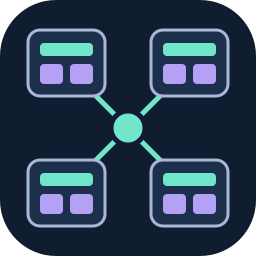
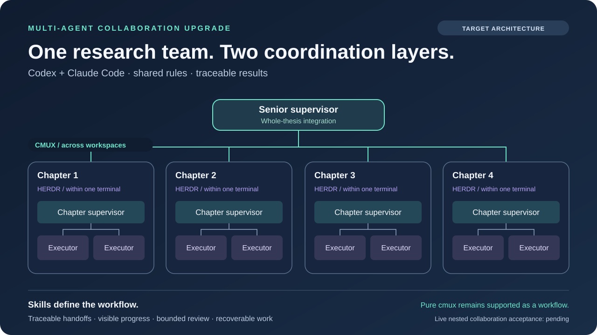

<p align="center"></p>

# Multi-Agent Collaboration Upgrade

[English](README.md) · [Agent 快速入門](docs/agent-quickstart.md) · [通用 Agent 指引](AGENTS.md)

這是一套供終端 Agent 使用的協作規則與實驗性相依任務規劃器。目標是結合 **cmux 的跨終端、跨工作區協調**與 **Herdr 的單一終端內部協作**，保留既有會話、可追溯交接和清楚的寫入責任。

**先從離線規劃器開始。** 目前預設分支包含歷史規劃器及繼承的 Claude Code／Codex 傳輸契約。下方巢狀架構是目標工作流程，不代表此分支已實現全部能力。正式實驗驗收仍為 **業務 0/33、配對比較 0/15**；尚未證明原生多 Agent 協作的實際提速。

## 執行離線範例

需要 Python 3.10 以上及 shell。這個範例不需要帳號、API Key、執行中的 Agent、cmux 或 Herdr。

```sh
git clone https://github.com/lzhs1995/multi-agent-collaboration-upgrade.git
cd multi-agent-collaboration-upgrade
python3 -B scripts/orchestration_planner.py validate --plan tests/fixtures/orchestration-plan.json
python3 -B scripts/orchestration_planner.py schedule --plan tests/fixtures/orchestration-plan.json
python3 -B scripts/orchestration_planner.py benchmark --plan tests/fixtures/orchestration-plan.json
```

2026-11-10 已實際執行這三條命令，使用未修改的預設分支規劃器，全部正常結束：

| 命令 | 實際輸出 | 能證明的範圍 |
|---|---|---|
| `validate` | `PASS`，7 個節點 | 範例符合任務圖契約。 |
| `schedule` | `PASS`，5 個執行批次，其中 2 批可並行 | 相依關係、執行者及寫入範圍限制共同決定排程。 |
| `benchmark` | `offline_schedule_estimate`；790 → 600 秒、減少 24.051%、1.317 倍 | 由測試資料預設時長計算的排程估計，**不是 Agent 實際執行時間**。 |

規劃器不會因此派發任務、呼叫模型、安裝 hook 或啟動會話。範例中的會話標籤與輸入路徑只是測試資料，不得拿來證明真實身分。閱讀本倉庫也不需要執行繼承的 MAC 安裝器。

## 目標架構：向外協調，向內協作



以包含四個核心章節的博士論文為例：每章使用一個 cmux 工作區，內含一個 Herdr 會話。章節主管（supervisor）將有明確範圍的工作交給執行者（executor），收取並整合成果。四個章節主管再跨工作區，與總主管（senior supervisor）共同處理全稿的定義、方法、證據及章節銜接。

| 層次 | 責任 | 本倉庫現況 |
|---|---|---|
| 終端內的 Herdr | 章內角色、局部交接、進度、審查與恢復 | 目標流程；此處未認證 Herdr 原生轉接器。 |
| 終端／工作區之間的 cmux | 找到正確主管、保留會話身分、傳遞跨團隊交接 | 目標外層；本分支繼承的實際傳輸契約較窄，要求同一工作區。 |
| 共用協作規則 | 任務範圍、每個範圍單一寫者、收件、成果消費與有界審查 | 可閱讀並手動採用；自動強制執行取決於實際轉接器。 |
| 科研工作流程 | 來源忠實度、科學限制、章節驗收與全稿整合 | 由既有論文精煉助手掌管，不由終端執行環境取代。 |

cmux 與 Herdr 提供執行環境與操作能力，協作規則決定團隊如何使用它們。應保留**純 cmux 協作**、既有 [`multi-agent-collaboration`](https://github.com/lzhs1995/multi-agent-collaboration) 及**论文精炼助手／thesis-refiner** 兩套 skill。面向 Herdr 的內部規則模組可共用協作契約，遇到跨工作區交接時使用外層模組；不需要刪除或偷偷替換原 skill。

## 四種合作模式

| 模式 | 工作方式 |
|---|---|
| 自由對等 | 全員對等提案、比較及交叉互評；寫入共用成果前先指定整合者。 |
| 主持派發 | 主控分派有界任務，統一收斂答案。 |
| 分工管理 | 頂層拆解規格，專精團隊各自負責明確成果。 |
| 閉環迭代 | 依序執行實作、審查、修訂，預先指定停止條件。 |

這些是可複用的工作流程選擇，不是目前規劃器已實作的四種執行模式。

## 五條協作規則

1. **交接可溯源。** 帶上任務／會話身分、目標、輸入與結果的雜湊、寫入範圍、下一步及驗收條件。收到通知、讀完正文與接受成果是三個不同事件。
2. **進度看得見。** 在進行中的已授權協作階段，至少每分鐘更新一次；工作停止時通知主管。計時器或狀態檔本身不能證明 Agent 已被喚醒。
3. **雙向能喚醒。** 只使用轉接器支援的插話或排隊方式；核對原會話新增的使用者訊息含通知的唯一標記。若通知指向正文檔案，另行驗真並完整讀取正文；排隊或通知收到不等於正文已讀取消費。
4. **審核有上限。** 先做一次範圍明確的審查，之後只複核已報問題，合計最多三輪。重試與恢復不重置原審輪預算。
5. **中斷能恢復。** 執行有副作用的動作前記錄意圖；結果不明時只讀回原次，不為了取得更清楚的結果而重發、重設會話或重做動作。

## Agent 與平台能力

任何能讀取檔案的 Agent 都可使用這些規則；具備 shell 與 Python 時，可執行確定性的離線規劃器。這不代表它的原生 CLI 已是受支援的任務執行目標。

| 客戶端 | 文件入口 | 離線規劃 | 原生傳輸與完整閉環狀態 |
|---|---|---|---|
| Codex CLI | [AGENTS.md](AGENTS.md) | 有 Python／shell 即可 | 繼承的 schema 含 `codex_cli`；仍須核實當前會話、投遞與 callback。 |
| Claude Code | [CLAUDE.md](CLAUDE.md) → AGENTS | 有 Python／shell 即可 | 繼承的 schema 含 `claude_code_cli`；仍須核實當前會話、投遞與 callback。 |
| Gemini CLI | [GEMINI.md](GEMINI.md) → AGENTS；無法匯入時手動讀取 | 有 Python／shell 即可 | 本分支無 Gemini 原生傳輸，**未驗證**。 |
| OpenCode 及其他 Agent | 明確讀取 [AGENTS.md](AGENTS.md) 和[快速入門](docs/agent-quickstart.md) | 有 Python／shell 即可 | 本分支無 OpenCode 原生傳輸，**未驗證**。 |

指令檔自動載入取決於客戶端及版本，尚未跨所有客戶端實測。schema 只接受 Claude／Codex 原生傳輸標籤，不得把不支援的客戶端改名來通過驗證。歷史原生流程需要 macOS 與 cmux；Linux 是離線測試目標，此版本未認證 Windows、tmux 或 ACP 互通。[ACP 清單](policies/acp-capability-matrix.json) 是帶日期的能力觀察，不是已實作的轉接器。

## 已交付與尚待驗證

狀態日期：**2026-11-10**。文件更新不代表實驗執行碼已獲晉升。

| 範圍 | 證據與界線 |
|---|---|
| 預設分支執行碼基線 | 歷史規劃器 [`4bedae2`](https://github.com/lzhs1995/multi-agent-collaboration-upgrade/tree/4bedae241ddf72a0194690e8cfbfcc8a9e75d77a)；上述三條離線命令已通過。 |
| 獨立實驗候選 | [`fix/official-native-topology-20261105`，固定 `a264ce0`](https://github.com/lzhs1995/multi-agent-collaboration-upgrade/tree/a264ce06e17b2facd4590e1d16d95cefbb745cbf)；[Ubuntu／macOS × Python 3.10／3.14 四組 CI 通過](https://github.com/lzhs1995/multi-agent-collaboration-upgrade/actions/runs/42622913098)。結果僅屬該候選。 |
| 正式實驗驗收 | **業務 0/33；配對比較 0/15。** 準備、CI 與獨立診斷不能填入這些樣本。 |
| 原生協作效率 | **尚未驗收。** 範例的 24.051% 不是實際提速；配對實驗也不是 Herdr 與 cmux 的優劣比較。 |
| 巢狀章節團隊與恢復 | 跨工作區主管協調、真實 callback／正文消費、三種可用性狀態及完整章節團隊整合，仍須端到端證據。 |

歷史規劃器細節見[排程文件](docs/ORCHESTRATION.md)、[離線驗證](verification/ORCHESTRATION-VALIDATION.md)及[繼承的原生 SKILL 契約](SKILL.md)。其中 `multi-agent-collaboration` 名稱與舊平台描述保留作歷史材料，不是覆蓋已安裝 skill 的指令。實際科研任務應使用當前已授權的領域 skill。

公開範例應採用可攜路徑與合成資料；憑證、私有逐字稿及帳號設定不應進入公開提交，詳見 [SECURITY.md](SECURITY.md)。[隱私清理範圍](docs/publication-privacy.md)記錄本次測試資料清理：舊提交與其他分支頂端仍保留歷史私人內容，整個 Git 歷史的脫敏尚未完成。

MIT。cmux、Herdr、Codex、Claude Code、Gemini CLI 與 OpenCode 均為獨立專案；本倉庫不代表其背書，也不保證所有版本均相容。
