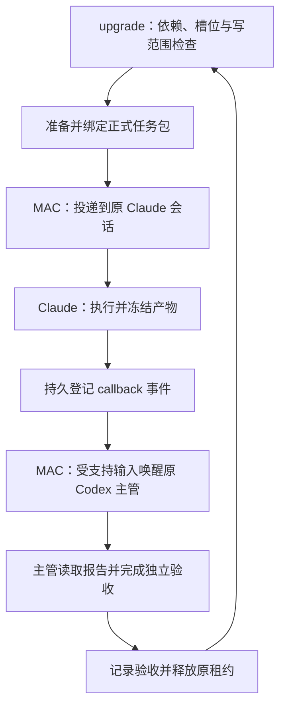

# 多 agent 协作提效报告

执行进度已由 [2026-10-18 压力与真实协作验证](VALIDATION-20261018.md) 更新。
下文 r4 状态保留为历史记录；当前 r8 三端 adoption 已通过，但原生 400 导致
pilot 0/3、pairs 0/15，尚未证明提效。平台架构分析与其原始证据日期不变。

更新日期：2026-10-18。用户已授权的 r4 已启动一次，双 Claude 完成原生 readiness，Codex 的物理 socket 已创建；Codex CLI 因重复 trust 参数退出，工作区 ref 解析也出现误判。r4 已封存为 HALTED/FAILED，当前修复进入完整离线验证。平台源码、Issue、PR 结论仍沿用 2026-10-16 的固定 gh CLI 证据，不代表重新核查后的线上状态。

**建议继续完善 upgrade 的调度闭环，以 Orca 为任务编排的主要架构参考，吸收 Paseo 的主动 callback，通过 MAC 复用原 Codex/Claude 会话。cmux 承载终端，CCC 承担运行维护，thesis-refiner 承担学术工作流与验收。**

若必须从四个候选中选一个做进一步适配实验，选 Orca。但目前没有相同工作负载的跨平台实测，不能认定 Orca 最快，也不能认定更换终端即可消除协作等待。当前路线优先利用已有实现；它的效率收益仍需验证。

## 1. 现在进展到哪里

| 事项 | 可确认的状态 | 尚未完成 |
| --- | --- | --- |
| 四个平台与自身四个仓库的核查 | gh 资料、源码与相关 Issue/PR 审计完成；完整报告有固定提交引用 | 未做跨平台性能实验 |
| upgrade 实现 | 已有持久协调器、依赖、claims/leases、FIFO、drafts、continuation、时间线，以及注册、permit、自动 driver、原生 bootstrap 和测量闭环 | 全链路 live adoption、callback、独立验收及连续续派尚待证明 |
| 离线验证 | r4 冻结源码曾通过 1706 项全测；本次 wrapper/workspace 修复先通过 42 项定向测试，新增 inspector 整体接线回归后其 11 项全部通过 | 本次新源码以独立完整验证回执为准；历史全测不覆盖后续修复，离线测试不等于 Claude 独立验收 |
| 代码发布 | [Draft PR #1](https://github.com/lzhs1995/multi-agent-collaboration-upgrade/pull/1) 已存在 | Draft 不等于合并、部署或活跃客户端采用 |
| r4 双 Claude | 两条真实原会话完成 readiness；只读诊断关联到各自原生调用和自动 PreToolUse／PostToolUse hooks | 诊断未证明全部隔离与输入门禁，未发布 adoption，未派发业务 |
| r4 Codex | 物理 socket 创建成功；CLI 因重复 `--dangerously-bypass-hook-trust` 退出，未建立 native session | r4 HALTED/FAILED，1 permit、0/33 closures；r2/r3/r4 原会话与尝试保留 |
| 当前修复 | 私有 wrapper 在最终 argv 合并处去重；完整 cmux 创建返回值通过同一份 tree 严格解析 ref/UUID；保留身份和隔离检查 | 完成新源码全测、冻结与候选准备后，再确认是否超出既有禁止 replacement/replay 的授权边界 |
| 效率收益 | 当前注册目标为 3 轮 pilot＋12 对 warm＋3 对 cold，共 33 slots、15 pairs | pilot 0/3；warm/cold 实跑结果、正确性通过、至少 15% 提速均未证明 |

历史握手问题是 ref/UUID 表示混比：原 Claude 收到通知并回复 ACK，主管仍拒绝核收。私有控制器已加入 canonical recipient 兼容修复；原共享会话及失败 receipt 仍保留，不能把新私有代码当作旧会话已完成核收。

r3 的 `/bin/ps` 与物理 socket 故障已修复，r4 已跨过 socket 创建边界。r4 暴露出两处后续问题：wrapper 与 startup 重复添加 trust 参数；inspector 把 `OK workspace:1000020047` 误当必须包含 UUID 的响应。修复只改变新私有候选，不修改原会话或冻结控制器。当前代码审查与测试是 SOLO；双 Claude 原生 readiness 和自动 hooks 有证据，但业务验证仍未完成。

## 2. 两份原分析哪些成立，哪些不成立

**内容一可以作产品介绍，不能用来得出编排效率排名。内容二重视接收与验收的区分是对的，但“四个都不适合，Orca 会更慢”的推论不成立。**

| 关键说法 | 审计结论 |
| --- | --- |
| Orca stars 多、界面完整，所以最适合 | stars 与功能数量不能证明就绪等待、callback 延迟或失败恢复成本 |
| Orca 默认每次等 10–15 分钟 | 这些是超时上限，消息到达可提前返回；异常路径反复耗尽超时确实会拖慢故障发现 |
| Orca 每次必须新开 agent/worktree | 活终端结算后可复用；支持 folder workspace。关闭后的会话恢复是另一个问题 |
| Paseo 完成只是 UI 通知 | 源码会主动给 caller agent 发送 prompt，能续起主管；但通知持久性和活动任务替换需要补强 |
| cmux 没有任何消息编排设施 | 有真实消息生命周期、事件流和 lease；这不等于已提供适合本任务的完整自动调度器 |
| Conductor 没有第一方仓库/Issues | 官方组织有 releases 仓库和 Issues；本次未找到可审计的应用实现源码 |
| Paseo 是 AGPL | 实际许可证为 Apache-2.0；Orca 为 MIT |
| upgrade 只是图校验与任务包种子 | 已过时：当前已有持久协调器及恢复、租约、预览和下一步建议，仍缺连续自动执行闭环 |

Issue/PR 只在对应版本、provider 和复现条件内成立。未合并 PR 不能算已发布，已合并修复不能继续当成现版本必现故障，用户报告的次数也不能当成本机测得的失败率。

## 3. 四个平台如何取舍

| 项目 | 最值得采用的能力 | 与当前需求的主要差距 | 建议 |
| --- | --- | --- | --- |
| **Orca** | Task/依赖、权威 Dispatch、持久邮箱、FIFO/ACK、结算后复用 | 支持的 Run 本身不自动调度；投递与业务验收合同不同；接管原 cmux 会话需要适配 | **首要编排架构参考，也是整套替换实验的第一候选** |
| **Paseo** | 按已有 agentId 发后续内容；完成事件主动续起主管 | 普通 prompt 可替换活动 run；完成订阅主要在内存；通用依赖与独立验收仍需补齐 | **重点吸收 callback 唤醒机制，整体运行时排第二候选** |
| **cmux** | 原有会话、终端、消息、事件与操作面 | 审计文档中的 Codex hooks 不能唤醒 idle Codex；缺少已核定的目标任务自动调度闭环 | **继续作承载层，调度交给 upgrade** |
| **Conductor** | worktree 并行与工作台体验 | 无应用实现源码，难核验持久通知、去重和会话复用保证 | **暂不作为可改造调度底座首选** |

上述排序针对架构适配性与可审计性，不是测得的性能排名。cmux 的保留理由是它与现有会话、MAC、CCC 的操作面一致；将来其他平台若能满足同一合同并在实跑中胜出，仍可迁移。

## 4. 当前到底慢在哪里

已有证据能确认历史核收缺陷及 r3/r4 启动失败；自动 driver 已实现，但完整 live 闭环尚未跑通。其他环节各占多少时间，尚无完整现场时间线。先区分三类时间：

- **业务计算**：Claude 阅读、推理、写作、分析和审查。
- **平台等待**：provider 排队、限流、压缩、断连与恢复。
- **协作空等**：有任务可做却没有派发，产物已冻结却没有发现，callback 已发生却主管未醒，验收已完成却没有释放资源和续派。

提效首先压缩第三类，并单列第二类。并发流程中这些时间可能重叠，不能把所有节点时长直接相加当成总墙钟。

| 等待来源 | 当前事实或待测假设 | 改进方向 |
| --- | --- | --- |
| 握手/核收 | 本次确有 ACK 被身份表示比较挡住 | 先修兼容问题与迟到 ACK 核收；把长期会话绑定和每个新任务授权分开 |
| 主管逐步手动推进 | driver、bootstrap 与续派指令已实现，live 闭环尚未证明 | 通过 adoption 后实测确定性推进及原主管独立验收 |
| 等整波最慢任务 | 是波次策略的潜在损耗，现场占比待测 | 依赖验收、槽位与写范围均满足后立即安排该节点 |
| 临到派发才准备材料 | 已有 drafts，但持续自动消费尚未接通 | 提前生成静态包，依赖完成后只绑定实际产物与最终授权 |
| callback 无法续起主管 | 文件观察器不唤醒模型；原生输入仍需可用通道 | 持久登记事件，通过原主管受支持的输入路径唤醒 |
| 重复扫描、重跑 checker | 已有只读 next-action 可利用，调用成本待测 | 只消费增量事件；观察状态与执行验收分开 |
| 故障拖住所有工作 | 本次核收故障影响了正式审查派发 | 停止受影响会话或依赖分支，其他已授权且无依赖的工作继续 |

更多 agent 并不自动更快。任务有强依赖、共享写范围、provider 并发额度不足，或主管审查成为瓶颈时，增加执行者只会增加协调成本。

## 5. 按什么顺序改，才最可能见效

实现和验证进度如下。离线完成不代表 live 通过。

| 顺序 | 具体改动 | 缩短什么等待 | 完成标准 |
| --- | --- | --- | --- |
| **P0：私有启动修复** | 精确 socket 已在 r4 创建成功；新增 wrapper 参数去重及严格工作区响应解析 | 消除启动与核收前置阻断 | 修复源码全测、固定候选、必要的新实验授权后，真实原生启动与自动 adoption 通过 |
| **P1：时间线** | 已实现只读 timeline、原生事件关联和测量工具 | 识别真实高耗时阶段 | live 证据完整；缺失为 null/UNKNOWN，不回填推测时间 |
| **P2：事件与就绪** | 已实现持久协调、依赖检查、continuation、permit 与单 driver 所有权 | 减少轮询和整波等待 | 实测重启不重复派发、只有一个写者，正确释放依赖 |
| **P3：原会话派发** | 已实现 drafts、正式包、原 harness/bridge、会话复用指令 | 减少重复准备 | 同组全部 warm 轮复用原三会话；未知结果只核原尝试 |
| **P4：callback 与验收** | 已实现真实 callback 合同、原生主管输入和独立验收指令 | 减少完成后的人工续起 | 三轮 pilot 逐轮证明接收、正文读取、验收、释放和自动续派 |
| **P5：配对实跑** | 已注册 33 slots、15 pairs 及完整失败分母 | 量化实际收益与成本 | 12 warm＋3 cold pairs 完成；失败、provider 等待、人工干预和费用均披露 |

最小可用闭环应先覆盖“两条已有 Claude 会话＋小型依赖图”，贯穿就绪、派发、callback、验收、释放和续派，再扩大并发。新的 Jev/TypeSafe 模型服务、更多 UI 或大规模自动拆任务，可在这个闭环测出收益后再评估。当前 Jev/TypeSafe 是 advisory/mock 接缝，真实 campaign 使用 rules。

确定的机械步骤交给程序：依赖是否满足、槽位是否可用、写范围是否冲突、哪条事件尚未消费。模型保留任务理解、分解、疑难判断和内容审查。无任务时等待事件，健康检查与业务任务超时分别计时，不靠不断调用大模型解释状态来维持循环。

## 6. 三项最关键的效率设计

### 满足依赖即续派

同一任务图、两条执行会话，假设 A 需 2 分钟、B 需 10 分钟，二者独立；C 需 6 分钟且只依赖 A；D 需 2 分钟且依赖 B、C。

| 策略 | 安排 | 总时长 |
| --- | --- | --- |
| 整波结束再推进 | A/B 同时开始；第 10 分钟才启动 C；第 16 分钟启动 D | 18 分钟 |
| 按依赖连续推进 | A/B 同时开始；第 2 分钟启动 C；B/C 都完成后第 10 分钟启动 D | 12 分钟 |

这是人为设定的排程示例，假设验收和派发耗时为零，用来说明浪费来自无关任务之间的等待；**不是项目实测，也不承诺 33% 提速**。真实执行必须等所需产物验收及资源释放，不能以 worker_done 直接解锁依赖。

### 把准备工作移到执行期间

Claude 运行当前任务时，主管准备后继任务的稳定目标、输入结构、输出路径、验收清单和静态上下文。依赖通过验收后再填入真实产物哈希、任务授权和发送绑定。这样能压缩“资源已经空闲，主管还在写任务说明”的时间。

复用握手应分层：长期保存已验证的会话绑定与不可变合同，每次输入仍检查实际 session/turn、所有权与完整草稿；每个正式任务仍有独立授权和证据。**现行 task/nonce 绑定不能直接跳过**，跨任务复用完整握手需由共享维护者先修改并验证协议。不能把“减少重复成本”解释为关闭身份检查。

小任务应合并到有实质产物的工作包，例如按一条完整审查链分配，而不是每个字段、每个文件都新开一轮协商。任务应有足够有效工作来摊薄通信和验收成本，具体粒度由 P1 测量决定。

### 完成事件主动推动下一步

已实现的目标链路如下；箭头不表示 live 已验收或生产已采用：

cmux 承载这些原会话；CCC 观察并管理运行状态；thesis-refiner 为学术任务提供领域验收。避免它们各自建立第二套任务真值或第二个发送器。

多个完成事件可以合并为一次主管待办提示，减少模型轮次；每个 callback、原生接收和产物仍分别记账。持久 outbox 是待处理事件的记录，**不授权重发结果未知的原生输入**。系统重启可以重放本地状态事件，终端输入仍遵守原尝试核对规则。主管活动时用受支持的 steer，空闲时用原线程 start；通道不可用时保留待处理状态，不能以文件出现冒充唤醒成功。

## 7. 如何证明改善，而不是只让界面更忙

先测相同任务集从开始到最终业务验收的总墙钟，再解释其中协作空等的变化。必须固定任务图、模型/provider、并发数、机器、数据和验收标准；原会话复用与冷启动分组。

| 指标 | 起止点 | 用途 |
| --- | --- | --- |
| 就绪到接收 | 所有依赖验收且槽位可用 → 后继任务原生接收 | 核查调度是否让可执行工作空等 |
| 完成到主管处理 | 执行完成证据 → callback 原生收到 → 主管读报告 | 分开计算事件发现、传输和主管唤醒 |
| 验收到续派 | 产物验收 → lease 释放 → 下一任务原生接收 | 检查是否真正消除了任务间隙 |
| 总墙钟 | 同一工作集开始 → 最终业务验收 | 直接衡量用户是否更早得到可用结果 |
| 成本与正确性 | token、模型轮次、人工次数、失败/恢复、原生回执和报告哈希 | 防止用更多资源、漏验收或丢任务换取表面速度 |

当前设计取代历史九次策略试验：先以同一 Codex＋双 Claude 完成三轮连续 pilot，再进行 **12 对 warm＋3 对 cold**。A1 为原生主管调度（mac_native），B 为依赖建议/drafts/continuation（omo）；两臂都使用真实 callback 和独立业务验收。三类工作负载分别为词法索引及早期后继、fan-in、重叠写范围；每类 warm 顺序 AB、BA、BA、AB，cold 单列。七个会话组、33 slots 和 15 pairs 在启动前固定，最多两名 Claude 执行业务任务，只有一个全局 permit。禁止加入人工 sleep 制造收益。该试验不包含 Orca/Paseo，不能证明跨平台优越性。

采用门槛为：**正确性和隔离全部通过、warm 配对改善中位数至少 15%、各类中位回退不超过 5%**。每轮正确收口不超过 1800 秒，B 不得依靠人工提示续跑。费用增加超过 10% 必须披露；token/账单缺证据记 UNKNOWN。失败尝试、恢复时间、provider 等待和人工补救全部报告，缺失轮次留在固定分母内。小样本报告完整结果、中位数与范围，不声称稳定 P95 或统计显著。早期 790 秒对 600 秒只是结构估算。

之后如考虑平台迁移，再单独对 Orca、Paseo 与升级后的当前栈做匹配实验；应用源码不可审计的 Conductor 可作单列黑盒候选。

## 8. 证据与交付文件

完整事实核查、固定源码链接及 Issue/PR 状态见：

- [四平台完整源码审计报告](/Users/lzhs/Projects/multi-agent-collaboration-upgrade/docs/PLATFORM-ORCHESTRATION-REVIEW-20261016.md)
- [gh 证据清单](/Users/lzhs/Projects/multi-agent-collaboration-upgrade-evidence/20261014-v1/platform-review-20261016-v1/evidence-manifest.json)
- [原报告引用校验结果](/Users/lzhs/Projects/multi-agent-collaboration-upgrade-evidence/20261014-v1/platform-review-20261016-v1/report-validation.json)
- [当前任务交接记录](/Users/lzhs/Projects/multi-agent-collaboration-upgrade/HANDOFF.md)
- [迟到 ACK 核收兼容问题维护请求，尚未送达](/Users/lzhs/Projects/multi-agent-collaboration-upgrade-evidence/20261014-v1/maintenance-surface11361/late-ack-ref-uuid-20261016-v1.request.md)

关键技术结论可直接复核：

- [Orca 的任务/Run 边界与支持的协议](https://github.com/stablyai/orca/blob/f51e82c4c26745f6a15e215e4391f533327697e2/skill-guides/orchestration.md#L46-L71)
- [Orca 消息到达时唤醒 waiter](https://github.com/stablyai/orca/blob/5db05e8ed4f41e29786016cd1f236bc0a5fcf88f/src/main/runtime/orchestration/mailbox-notification-coordinator.ts#L48-L75)
- [Orca 结算后复用原终端](https://github.com/stablyai/orca/blob/5db05e8ed4f41e29786016cd1f236bc0a5fcf88f/skill-guides/orchestration/references/coordinator-loop.md#L46-L58)
- [Paseo 主动 callback 与通知订阅](https://github.com/getpaseo/paseo/blob/dc5b02f7d7c120baea380d76def8b968020d8823/packages/server/src/server/agent/agent-prompt.ts#L440-L519)
- [Paseo 普通发送默认 replaceRunning](https://github.com/getpaseo/paseo/blob/dc5b02f7d7c120baea380d76def8b968020d8823/packages/server/src/server/agent/agent-prompt.ts#L341-L350)
- [cmux 消息机制及 idle Codex 唤醒限制](https://github.com/manaflow-ai/cmux/blob/6c23792198ce042b7ba2c018ca4e0b9d797a4235/docs/agent-messages.md#L23-L79)
- [Conductor 官方 releases 仓库](https://github.com/meltylabs/conductor-releases/tree/0095de9b888f2a37413a3a3666638344028d2f46)

本报告的后续执行依据是 [隔离实验 runbook](/Users/lzhs/projects/multi-agent-collaboration-upgrade/docs/ISOLATED-UPGRADE-RUNBOOK.md)。[r4 失败证据](/Users/lzhs/Projects/multi-agent-collaboration-upgrade-evidence/20261014-v1/validation/resume-20261018-r4-startup-failure/manifest.json) 和 [双 Claude 原生 readiness／自动 hooks 诊断](/Users/lzhs/Projects/multi-agent-collaboration-upgrade-evidence/20261014-v1/validation/resume-20261018-r4-startup-failure/native-readiness-03.json) 已保存。该诊断使用源码读取器，其私有 root 环境字段未采集，不冒充完整 adoption。最终候选的源码、测试日志、精确 socket 路径和新授权需求另行封存；不得修改或重放 r2/r3/r4。当前没有已测得的提速结论。
