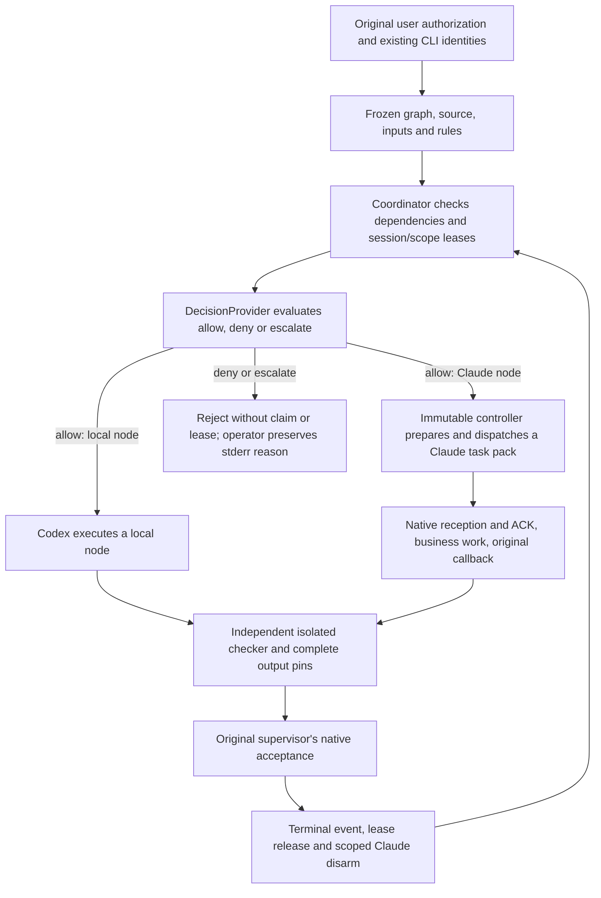

# CLI-owned orchestration and decisions

This independent upgrade adds a local decision provider, a durable coordinator,
and a verifier around the existing Codex and Claude Code sessions. It does not
install a shared service or replace the collaboration transport. The current
implementation is experimental; offline correctness is not a measured speedup.

## Decision mechanism

`scripts/decision_provider.py` defines `DecisionProvider.decide(context)`. Each
returned decision contains `outcome` (`allow`, `deny`, `escalate`), `reason`, `confidence`,
`evidence_refs`, `route`, and the actual provider's provenance.

The rules provider first requires authorization, verified identity, valid scope,
and verified evidence. Dangerous operations additionally require their specific
authorization. A route can use only the assigned, available original CLI session.
An unavailable session escalates; an advisory cannot substitute another executor.

An optional advisory runs only after those hard gates pass. Advisory exceptions
fall back to rules; an allow below the confidence threshold escalates. Neither
fallback nor confidence grants authority. `offline_mock` exercises this seam in
tests. **A real campaign accepts only the frozen `rules` provider.** No TypeSafe
SDK, Jev/Noul service, external model API, or provider credential is used here.
A future adapter would need an explicit contract for any missing confidence
field; it must not invent a score for a provider that supplies none.

The frozen runner's `claim --run <run> --node <node>` is the action that requests
a new rules decision for a `PENDING` node. An already claimed node returns its
existing record without requesting another decision. An allowed claim persists its gates and decision before
reserving its session and write scope. A denied or escalated decision exits 2
with a `REJECTED` reason on stderr before writing a claim or lease; the operator
must preserve that output separately. Exit 2 also covers refusals before the
decision, such as an unready node or invalid ownership; the stderr reason must
distinguish these from deny/escalate outcomes. Later verification recomputes accepted
decisions from the frozen rules and checks for a match.

## How a task runs



The CLI agent performs the business command. The runner prepares claims,
requests, transport and evidence; it does not perform the agent's work or append
synthetic native messages. The checker executes as a separate `python -I -B`
process and independently recomputes the answer without importing the workload.
Codex local-node review is labelled `solo_self_review`, not dual-agent consensus.

`orchestration_coordinator.py` implements three policies over the same graph:

| Policy | Behavior |
| --- | --- |
| `serial` | One eligible node runs at a time in graph order. |
| `omo` | Dependency-ready nodes can run concurrently in distinct CLI lanes. |
| `codeg` | Each original session has a durable FIFO; a blocked head waits for its dependency. |

All policies enforce one active node per session and nonoverlapping write scopes.
Missing dependencies are errors, not implicit success. Every successful claim and lifecycle
event is durable. A consumer pins the accepted producer's evidence and complete
outputs from the same run. Cross-run substitution is rejected.

Uncertain input retains its lease. Recovery observes original journals, never
resends a prompt or changes its nonce. Failure settlement requires a proven safe
boundary; a missing result or empty timestamp is insufficient. Native logs
separately prove reception, tool completion, callback and acceptance. Models,
process identity, clocks, complete trees, and artifact hashes are revalidated.

## Interrupted preparation and recovery

`orchestration_maintenance.py` supplies a separately pinned adapter for an older
campaign whose original preparation is blocked. It preserves that campaign's
source, controller, Python, authorization, claim, event prefix and lease. The
maintenance manifest binds the original reservation timestamp as well as its
session, scope and claim. Validation uses leaf registry reads so replay cannot
recurse through state, failure evidence and maintenance validation.

The public entrypoint checks the exact loaded adapter modules and the separately
loaded controller parser. The adapter's dependency validator includes deferred
imports and the private literal parser, and rejects adapter `.pyc`, `.pyo` and
`__pycache__` inputs. This validates the supported, reviewed flat source layout;
it is not a sandbox for arbitrary Python or dynamic loaders.

A failure candidate still needs a proven original safe boundary and exact native
supervisor settlement. Release compares the original lease identity under lock.
Public disarm and bounded recovery hold the existing node locks through the
synchronous operation, observation and receipt. Internal recovery helpers rely
on that caller-held lock; surviving fork/exec descendants are outside this
guarantee. Recovery never resends the original business input.

Evidence is staged and atomically published without overwriting an existing
exclusive result. Subprocess-crash tests cover interrupted publication and lost
returns. They do not establish power-loss durability; abandoned stages are
preserved rather than accepted as completed evidence.

`orchestration_refusal.py` can compare an original call, command-execution record
and result with the pinned historical controller source. Its strongest result is
`MATCHED_STATIC_ONLY`. Static source reasoning cannot attest to historical
startup injection, the complete process's writes or invocation-time body and
artifact identity. It always leaves settlement and input retry unauthorized;
exit code 2, missing journals and current file hashes do not fill those gaps.

## Deployment boundary

The upgrade is managed in
[multi-agent-collaboration-upgrade](https://github.com/lzhs1995/multi-agent-collaboration-upgrade).
`orchestration_freeze.py` copies the complete adapter and input corpus into a
private campaign directory and pins an existing immutable collaboration release,
Python executable, original sessions/models and native user authorization.
`orchestration_run.py` refuses execution from the mutable checkout; invoke its
frozen copy with the separately trusted campaign SHA256.

Prepare the adapter from a clean source export of the reviewed revision, in a
different directory from the checkout used for tests. Keep
the working checkout's caches intact; exclude caches from the new export and
verify the complete export and dependency closure before use. Python `-B` stops
new bytecode writes but still permits existing bytecode reads. A source-only
adapter does not certify the separately pinned controller or standard library
as bytecode-free.

This is explicit, local orchestration. Installing the repository does not make
every existing collaboration task use it automatically. Shared runtime and skill
updates remain the designated shared maintainer's responsibility. The legacy
`manage_install.py` in this historical source is not the upgrade's deployment
entrypoint and must not be used to replace current shared hooks.

At the 2026-10-15 checkpoint, 1,514 offline tests pass and the real older
campaign remains blocked at its first Claude preparation. The first read-only
original-history diagnostic returned `UNMATCHED`; after the V20 parser repair,
a second diagnostic over the identical original record interval returned
`MATCHED_STATIC_ONLY`. Both results remain preserved, and neither authorizes
settlement or retry. Shared 0.4.35 has not been
verified as published or installed; the observed shared release is 0.4.34.
Neither explicit local packaging nor offline validation proves active-client
hook adoption or measured efficiency.

## Workload and measured promotion

The v2 corpus workload has four nodes: Claude `inventory`, Codex
`dependent_local` consuming that inventory, independent Codex blob verification,
and Claude `verify_inputs`. The same 82 fetch records, including failed and
zero-byte fetches, and 48 verified Git blobs are used by all policies.

The policy probe estimates 170 / 105 / 125 seconds for serial / omo / codeg.
These numbers only demonstrate that the graph distinguishes the policies; no
delays are inserted into real work. The older seven-node 790→600 second fixture
and its 24.051% reduction also remain offline estimates.

Real promotion requires all nine runs in this fixed counterbalanced order:

```text
serial → omo → codeg
omo → codeg → serial
codeg → serial → omo
```

Every run must pass correctness and the delivery contract. At least one
candidate's median elapsed time, human interventions, or retries must improve
by at least 15% over serial. A zero baseline cannot yield a percentage; missing
measurements stay `null`. Provider automatic retries are counted separately.
No additional absolute-count threshold has been approved. Publish all per-run
results and retain the three-observations-per-policy and session-carryover limits.

The v1 `validate_replay_evidence.py` is **HISTORICAL_ONLY** (exit 3), including for
previously passing v1 fixtures. It cannot promote results. The v2 runner's
`verify-campaign` performs current validation. See the
[live runbook](LIVE-REPLAY-RUNBOOK.md) and
[verification record](../verification/ORCHESTRATION-VALIDATION.md).
