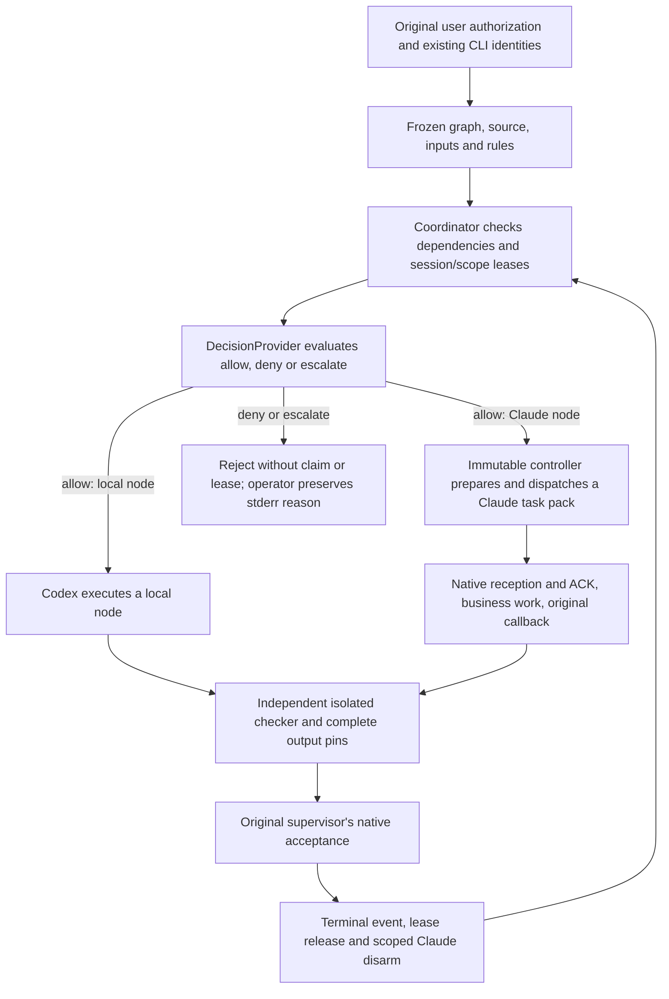

# CLI-owned orchestration and decisions

This independent upgrade adds a local decision provider, a durable coordinator,
and a verifier around the existing Codex and Claude Code sessions. It does not
install a shared service or replace the collaboration transport. The current
implementation is experimental; offline correctness is not a measured speedup.

## Current v3 execution (2026-10-19)

The current experiment compares a parallel-capable native A1 supervisor with
B dependency scheduling over 33 business slots, 15 pairs and 192 separately
registered ordinary messages. The nine-run v2 matrix below is historical and
does not replace this registration. See the [isolated runbook](ISOLATED-UPGRADE-RUNBOOK.md).

B uses `advance --run RUN --max-steps 12 --max-seconds 45` on the pinned
`orchestration_run.py` runner, with the original campaign path and SHA arguments.
It batches eligible claim, prepare, dispatch, original-attempt reconciliation,
callback import, candidate creation, release repair and disarm. Each action
reloads authoritative state and enters its original gate. Within one invocation,
eligible independent lanes are claimed before transport; a prepared lane then
dispatches before another lane enters a potentially slow handshake. Closeout,
review and reconciliation retain their outer priorities. Per-call attempt counts
prevent a refused action from monopolizing that call; they do not guarantee
fairness across repeated one-step calls after a refusal before input intent.
UNKNOWN grants no resend. A1 retains its manual entrypoints
and can dispatch both independent Claude lanes concurrently.

The returned `supervisor_actions` and waiting recovery commands are executable
handoffs. Native START, local business work, independent review/ACCEPT and FINISH
remain the real supervisor's responsibility. An existing local action or native
acceptance is collected or recovered, never repeated after a lost return.
Once this call has generated a review/acceptance handoff that remains current,
it returns that handoff before entering another synchronous prepare, dispatch,
reconcile, callback or disarm operation. Existing local-business handoffs keep
priority. The final state refresh removes stale handoffs or returns the original
acceptance recovery command. This shortens avoidable supervisor waiting without
automatically accepting work or releasing ownership. Synchronous transport itself
still waits; changes to this selection policy do not alter frozen R32 controllers.
The defaults are one action and 45 seconds; limits are 32 actions and 600 seconds.
The action budget begins after the first complete fenced observation. Later
observations count against it, and time is checked again before the next action.
The result separately reports `initialization_seconds`, `action_elapsed_seconds`,
`finalization_seconds` and total `elapsed_seconds`. The original run/watchdog
deadlines never reset. This budget cannot cancel a synchronous preparation
already running. This is an explicit foreground invocation, not an idle-model
waker or a background scheduler. The experiment must establish whether fewer
supervisor round trips shorten accepted-work time without lowering correctness.

## Decision mechanism

`scripts/decision_provider.py` defines `DecisionProvider.decide(context)`. Each
returned decision contains `outcome` (`allow`, `deny`, `escalate`), `reason`, `confidence`,
`evidence_refs`, `route`, and the actual provider's provenance.

The rules provider first requires authorization, verified identity, valid scope,
and verified evidence. Dangerous operations additionally require their specific
authorization. A route can use only the assigned, available original CLI session.
The standalone rules provider can escalate an unavailable-session context;
an advisory cannot substitute another executor. A node a frozen plan declared
*deliberately unbound* escalates with its own distinct reason, "the frozen node
is deliberately unbound; bind it before claiming", so it is never confused with
an assigned session that happens to be unavailable. That branch reads one
explicit context fact (`executor_binding == "UNBOUND_PENDING_BIND"`), never a
missing or `None` executor: a context-assembly bug must not become the benign
unbound path. An `executor_binding` naming no known provider is denied. The current coordinator derives
`available_executors` from authenticated identity lanes and requires the complete
original pair. Missing identity therefore fails a hard gate, before an
unavailable-session escalation can be used. A running, authenticated CLI does
not establish model-provider health: this route neither detects an API 403 nor
automatically changes a Claude node to SOLO.

An optional advisory runs only after those hard gates pass. Advisory exceptions
fall back to rules; an allow below the confidence threshold escalates. Neither
fallback nor confidence grants authority. `offline_mock` exercises this seam in
tests. **A real campaign accepts only the frozen `rules` provider.** No TypeSafe
SDK, Jev/Noul service, external model API, or provider credential is used here.
A future adapter would need an explicit contract for any missing confidence
field; it must not invent a score for a provider that supplies none.

`scripts/jev_advice.py` is the offline truth table such an adapter would feed.
It covers only supervisor triage before a task pack is frozen and bound; a bound
task gets `NOT_CALLED`. For routing, the work-kind Choice has a companion Noul:
below 0.3 rules decide, from 0.3 to 0.7 the supervisor decides, and above 0.7
the advice lists verified lanes with an idle write domain (a non-author Claude
for review), or `NO_IDLE_LANE`. A failed or malformed answer is `JEV_ERROR` or
`NOT_CONFIGURED`, never a "no". Inbox advice only moves a message forward above
0.7; every body is still read in full. Confidence is not a gate. The module
itself still makes no request, and no campaign registers an advisory provider:
`claim` continues to accept only the frozen `rules` provider.

Two offline consumers now read that truth table. `orchestration_binding.eligible_candidates`
reaches `jev_advice.route_advice` through its public API to recompute the
admissible lanes in code at binding time, so the bind-time candidates and the
truth table cannot drift apart. `scripts/jev_advice_worker.py` is a separate
module whose only transport is an injected callable: with none, and with no
budget, it can answer only `NOT_CONFIGURED` with `fallback="rules"` and zero
model requests. That is the only answer reachable here, because no code path
reads a budget, a limit or a key from a file or an environment variable, and no
HTTP or SDK client ships. A failed or malformed answer stays an error, never a
"no". `jev_advice.py` is unchanged: its bytes still match the sha256 pinned in
the frozen R62 design.

Because `orchestration_binding` imports `jev_advice` at module level, E3 adds
three modules to every new frozen maintenance and campaign closure, not the two
the design's invariant 6 names: `orchestration_binding`, `upgrade_advice_chain`
and `jev_advice` (pinned by `BindClosureTests`). `verify_tree(adapter)` covers
all three files' bytes. `upgrade_advice_chain` and `jev_advice` are outside
`bound_source`'s `orchestration_*` name filter, which design 4.2 keeps
unchanged, so their loaded-module origin is not re-checked. Every claim and
replay re-derives an unbound node's binding, so a maintenance replay of such a
claim does run `upgrade_advice_chain`. The design file lives outside this
repository and still names two members; its owner updates it.

The frozen runner's `claim --run <run> --node <node>` is the action that requests
a new rules decision for a `PENDING` node. An already claimed node returns its
existing record without requesting another decision. An allowed claim persists its gates and decision before
reserving its session and write scope. A denied or escalated decision exits 2
with a `REJECTED` reason on stderr before writing a claim or lease; the operator
must preserve that output separately. Exit 2 also covers refusals before the
decision, such as an unready node or invalid ownership; the stderr reason must
distinguish these from deny/escalate outcomes. Later verification recomputes accepted
decisions from the frozen rules and checks for a match.

### Binding a deliberately unbound node before its claim

A plan on version 2 may opt in with `unbound_executor_policy: "bind_before_claim"`,
and only then may a node freeze the complete null triple (`executor`,
`execution_kind` and `transport` all explicitly `null`). A mixed triple, the
field on a v1 plan and any other policy string are all `PlanError`. Every
existing plan keeps today's refusal and today's bytes.

Such a node is bound by a separate pre-claim action, never by `advance`:

| Command | Use |
| --- | --- |
| `publish-decision --run <run> --node <node> --work-kind .. --actual-route .. --action .. --reason .. --advice-sha256 ..` | The fixed, closure-pinned publisher exclusively creates one decision inside the run tree and prints one complete envelope. |
| `bind-unbound --run <run> --node <node> --decision <path>` | Recompute every fact in code, then exclusively create `runs/<run>/bindings/<node>.json`. |

The decision used to be a file the supervisor wrote outside the run tree. It is
published instead by one fixed entrypoint whose sha256 is pinned in the frozen
adapter, so a native call and its result can be joined to that creation. The
printed envelope pins this run, node and supervisor session, the decision file's
path, bytes and sha256, the publisher's own pin and the campaign and advice
input pins. `decided_at` is deliberately left null in the file: the honest
decision time is the native timestamp of the publisher's own success record,
which only the join supplies, and a self-written stamp must not stand in for it.

`bind-unbound` accepts only the decision that publisher created for that node,
and recomputes in code what a JEV answer may never assert: permission through
the ordinary campaign gate, identity (`lane_verified` over the live identity
lanes), non-author and capacity (`lane_is_author` and `lane_idle_write_domain`
inside `eligible_candidates`), and the input version (`advice_inputs_unchanged`,
comparing the input refs recorded inside the sha-pinned advice body against the
run's frozen inputs). The actual route must be one of the candidates recomputed
at that moment; a route copied from the advice is refused. The step consumes the
same Stop, preserved-failure and run-budget gates as `claim`, and every refusal
precedes the single exclusive write, so a refused bind leaves no file, lease or
event behind.

A refused bind does leave its own native call and that call's failed result in
the transcript, and that is what makes a retry possible. The bind joins the one
invocation that has not returned yet, so a transiently refused bind - the bound
lane taken at that moment, a busy lock - is retried by invoking `bind-unbound`
again. Two invocations that are both still running are ambiguous and refuse.
The published decision is never republished, so without this a single transient
refusal would leave the node permanently unbindable.

The join requires one publisher call and exactly one matching result inside the
same original session fence: correctly paired, terminal rc0, complete output,
the call input equal byte for byte to the reconstructed frozen script, and an
envelope that pins the decision file's current bytes. A missing, duplicated,
failed, truncated or non-terminal pair refuses, as does a publish the
transcript places or stamps before the read it must follow. A transiently
refused publish leaves its own identical call and failed result, and the
decision is never republished, so identical calls are accepted when every one
already has exactly one result and exactly one result is the terminal rc0
success; an identical call still without a result, or two successes, refuse.
The window ends at the bind control call, so nothing the transcript gains after
the bind changes the verdict. On the on arm
the bind additionally requires one complete original read of exactly the advice
the decision cites; a range read, a truncated output or a digest-only output is
not a full read, and two valid pairs are ambiguous rather than consumed.

What that proves is bounded. `decision_publish_natively_joined` is true only
when the join above passes. `decision_write_natively_recognized` stays false and
`decision_write_proof` stays `NOT_RECOGNIZED_AT_THIS_HEAD`: a joined native
publish call does not audit the operating-system write, and the read proof is
the exact envelope plus the body field's bytes and sha256, not the sha256 of a
whole tool output. The "actual context" fact R62 names has no producer anywhere
in this repository and is recorded as `NOT_IMPLEMENTED_NO_PRODUCER`, not
invented. A fallback or stopped advisor (`NOT_CONFIGURED`, `JEV_ERROR`,
`NOT_CALLED`, `STOPPED_AUTH`) is never counted as advisory consumption, and an
on-arm node without a complete chain is `ADVICE_NOT_CONSUMED`.

The claim then pins that binding by path, bytes and sha256 under one new key,
`executor_binding`, present only for a node frozen unbound; a bound node that
carried it fails `"claim fields changed"`. Every later consumer resolves the
lane through that pin, so a binding edited after the claim fails replay instead
of silently re-routing an earlier claim. Unbound nodes join no lane FIFO: they
are listed in the run header as `unbound_nodes` under the opt-in, and `codeg`
refuses an opted-in plan that still carries one with a typed error instead of
returning the silent empty selection it used to. Two unbound nodes do not
collide with each other under `omo`. `next-action` recommends `bind-original-unbound-node` and carries
an instruction naming the required argv order, with no executable script, and
`advance` never performs the bind itself.

Two items the E3 design listed were deliberately **not** landed. C1, the
`jev_advice.idle_lanes` extraction, was cancelled so that `jev_advice.py` stays
byte-identical to its pinned sha256; `eligible_candidates` calls the existing
public `route_advice` instead. C11, the `METRICS_V3_ADVICE` measurement
definition, is not here either: it is the first candidate of a later increment,
no new metrics version exists, and `derive_run` attaches no advice chain.

## How a task runs



The CLI agent performs the business command. The runner prepares claims,
requests, transport and evidence; it does not perform the agent's work or append
synthetic native messages. The checker executes as a separate `python -I -B`
process and independently recomputes the answer without importing the workload.
Codex local-node review is labelled `solo_self_review`, not dual-agent consensus.
New ACCEPT executes this checker once, then rechecks the original candidate and
acceptance file pins before recording acceptance and releasing a lease. History
replay, status and recovery validate its recorded results and source/input/output
pins without spawning the checker again. One pure verification may share fully
authenticated native-root authority within its active thread/task scope, with
full entry/exit validation and fresh per-reader journal/fence checks. Every new
action retains its independent live gate. A copied context cannot revive a scope
after exit. These optimizations apply to both benchmark arms.

New v3 freezes register metrics version 4 (`output-effects-v1`). Successful,
completed native Claude `Read` calls and a finite directory-inspection command
may occur after the callback without becoming output writes. New task packs
render the exact command with their absolute paths:
`rtk proxy /usr/bin/env -i PATH=/usr/bin:/bin LC_ALL=C /bin/sh -f -c 'ls -la /ABS/OUTPUT'`.
Use native Claude `Bash` or native Codex `exec_command` with `login:false` and
`tty:false`; arbitrary `functions.exec` JavaScript remains unknown. The policy
trusts the system env/sh/ls binaries and configured RTK proxy forwarding, not
arbitrary wrappers. Failed, unfinished and unknown calls remain potential
writes; output verification must finish before the callback when the native
tool does not support this form. Explicit output-path attribution now includes
shell separators and is not suppressed by a control-script name in arguments.
It cannot prove effects hidden behind aliases, relative paths or arbitrary
programs. The three earlier metrics definitions and their task packs preserve
their original meaning and bytes: R32's bare post-callback `ls` remains its
original failure. This new template and policy apply only to newly frozen tasks;
local regression results do not establish live correctness or speedup.

`orchestration_coordinator.py` implements three policies over the same graph:

| Policy | Behavior |
| --- | --- |
| `serial` | One eligible node runs at a time in graph order. |
| `omo` | Dependency-ready nodes can run concurrently in distinct CLI lanes. |
| `codeg` | Each original session has a durable FIFO; a blocked head waits for its dependency. |

All policies enforce one active node per session and nonoverlapping write scopes.
Missing dependencies are errors, not implicit success. Every successful claim and lifecycle
event is durable. A consumer pins the accepted producer's evidence and complete
outputs from the same run. Cross-run substitution is rejected.

Uncertain input retains its lease. Recovery observes original journals, never
resends a prompt or changes its nonce. Failure settlement requires a proven safe
boundary; a missing result or empty timestamp is insufficient. Native logs
separately prove reception, tool completion, callback and acceptance. Models,
process identity, clocks, complete trees, and artifact hashes are revalidated.

## Observe waiting and prepare packages

The frozen runner exposes two read-only, advisory commands:

| Command | Use |
| --- | --- |
| `drafts --run <run>` | Preview all packages in dependency order, including original session, scope, inputs, deliverables and verification. Review the next package while current work continues. |
| `next-action --run <run>` | Read recorded lifecycle, original operation journals, pinned evidence and session/scope leases; report each node's waiting point and proposed gated action. |

Drafts are deterministic JSON previews of the frozen plan, not finalized task
packs or an additional persistent queue. Their contents remain stable while
dependencies run. They contain dependency IDs but no accepted dependency output
bindings, claim nonce or reservation. At `claim`, the existing coordinator
independently builds the actual request from accepted outputs in the same run.
Reviewing a draft early does not authorize dispatching it.

`status --run` and `ready()` replay full acceptance, including business-checker
subprocesses. Frequent monitoring through those paths repeats that work.
`next-action` uses recorded events instead; it checks transition shape,
claim/decision provenance, evidence hashes and lease ownership without executing
checkers or constructing transport. It rechecks events, leases and control-file
publication before returning, rejecting a view that changed during the read.
This includes a dispatch intent published before its lifecycle event.
The view remains a point-in-time advisory, not a lock or authorization:
`acceptance_revalidated=false`, `dispatch_authorized=false`, `input_operations=0`.
Subsequent actions still run the full existing gates. Large evidence trees can
still require substantial reading; no latency reduction has been measured.

| Waiting case | Advice and remaining work |
| --- | --- |
| Current task active; next scope already known | Review a draft now. Bind accepted dependencies and claim only when its original lane and scope permit. |
| Dependency accepted; executor idle | Propose `claim` from recorded readiness, then perform fresh live identity and dispatch checks. Nothing is sent automatically. |
| Original operation failed, lost its result, or recorded input intent | Preserve that operation and use its original observation/reconciliation path. Do not create a second submission. |
| Frozen candidate ready | Review and accept through the original native control; recorded readiness does not replace independent acceptance. |
| Terminal event recorded, lease or disarm unfinished | Show release and scoped disarm separately; do not treat the executor as free solely because business work finished. |
| Claude provider unavailable | Preserve the original session. The supervisor can continue separately authorized owned work as `solo_self_review`; this observer does not transfer task ownership or repair authentication. |

Lifecycle intervals name their actual recorded endpoints. Missing endpoints
remain `null`; monotonic durations across boots or discontinuous clocks remain
unmeasured. Operation intent/result wall times are recorded separately. These
intervals do not establish native reception, ACK, body reading, report freezing,
report discovery, report reading or callback reception. They cannot by themselves
attribute a delay to the network, model, hook, executor or supervisor.
Those stages need their own evidence. This increment supplies preparation and
diagnosis for cases such as callback-to-next-package waiting; a continuously
running dispatcher, shared hook adoption and live efficiency remain pending.

The observer increment has 17 focused offline tests and is included in the
1,532-test repository pass. Tests cover incomplete publication, uncertain input,
persisted acceptance, lease release, evidence changes during observation and
missing timing endpoints. The source and Python executable were pinned before
and after the suite; this increment remains `solo_self_review` while the original
Claude's V23 review is pending. See the
[validation record](../verification/ORCHESTRATION-VALIDATION.md) for exact pins
and the separate live-comparison requirements.

## Interrupted preparation and recovery

`orchestration_maintenance.py` supplies a separately pinned adapter for an older
campaign whose original preparation is blocked. It preserves that campaign's
source, controller, Python, authorization, claim, event prefix and lease. The
maintenance manifest binds the original reservation timestamp as well as its
session, scope and claim. Validation uses leaf registry reads so replay cannot
recurse through state, failure evidence and maintenance validation.

The public entrypoint checks the exact loaded adapter modules and the separately
loaded controller parser. The adapter's dependency validator includes deferred
imports and the private literal parser, and rejects adapter `.pyc`, `.pyo` and
`__pycache__` inputs. This validates the supported, reviewed flat source layout;
it is not a sandbox for arbitrary Python or dynamic loaders.

A failure candidate still needs a proven original safe boundary and exact native
supervisor settlement. Release compares the original lease identity under lock.
Public disarm and bounded recovery hold the existing node locks through the
synchronous operation, observation and receipt. Internal recovery helpers rely
on that caller-held lock; surviving fork/exec descendants are outside this
guarantee. Recovery never resends the original business input.

Evidence is staged and atomically published without overwriting an existing
exclusive result. Subprocess-crash tests cover interrupted publication and lost
returns. They do not establish power-loss durability; abandoned stages are
preserved rather than accepted as completed evidence.

`orchestration_refusal.py` can compare an original call, command-execution record
and result with the pinned historical controller source. Its strongest result is
`MATCHED_STATIC_ONLY`. Static source reasoning cannot attest to historical
startup injection, the complete process's writes or invocation-time body and
artifact identity. It always leaves settlement and input retry unauthorized;
exit code 2, missing journals and current file hashes do not fill those gaps.

## Deployment boundary

The upgrade is managed in
[multi-agent-collaboration-upgrade](https://github.com/lzhs1995/multi-agent-collaboration-upgrade).
`orchestration_freeze.py` copies the complete adapter and input corpus into a
private campaign directory and pins an existing immutable collaboration release,
Python executable, original sessions/models and native user authorization.
`orchestration_run.py` refuses execution from the mutable checkout; invoke its
frozen copy with the separately trusted campaign SHA256.

Prepare the adapter from a clean source export of the reviewed revision, in a
different directory from the checkout used for tests. Keep
the working checkout's caches intact; exclude caches from the new export and
verify the complete export and dependency closure before use. Python `-B` stops
new bytecode writes but still permits existing bytecode reads. A source-only
adapter does not certify the separately pinned controller or standard library
as bytecode-free.

This is explicit, local orchestration. Installing the repository does not make
every existing collaboration task use it automatically. Shared runtime and skill
updates remain the designated shared maintainer's responsibility. The legacy
`manage_install.py` in this historical source is not the upgrade's deployment
entrypoint and must not be used to replace current shared hooks.

At the 2026-10-15 observer checkpoint, 1,532 offline tests pass and the real older
campaign remains blocked at its first Claude preparation. The first read-only
original-history diagnostic returned `UNMATCHED`; after the V20 parser repair,
a second diagnostic over the identical original record interval returned
`MATCHED_STATIC_ONLY`. Both results remain preserved, and neither authorizes
settlement or retry. Shared 0.4.35 has not been
verified as published or installed; the observed shared release is 0.4.34.
Neither explicit local packaging nor offline validation proves active-client
hook adoption or measured efficiency.

## Historical v2 workload and promotion contract

The v2 corpus workload has four nodes: Claude `inventory`, Codex
`dependent_local` consuming that inventory, independent Codex blob verification,
and Claude `verify_inputs`. The same 82 fetch records, including failed and
zero-byte fetches, and 48 verified Git blobs are used by all policies.

The policy probe estimates 170 / 105 / 125 seconds for serial / omo / codeg.
These numbers only demonstrate that the graph distinguishes the policies; no
delays are inserted into real work. The older seven-node 790→600 second fixture
and its 24.051% reduction also remain offline estimates.

The historical v2 promotion contract requires all nine runs in this fixed order:

```text
serial → omo → codeg
omo → codeg → serial
codeg → serial → omo
```

Every run must pass correctness and the delivery contract. At least one
candidate's median elapsed time, human interventions, or retries must improve
by at least 15% over serial. A zero baseline cannot yield a percentage; missing
measurements stay `null`. Provider automatic retries are counted separately.
No additional absolute-count threshold has been approved. Publish all per-run
results and retain the three-observations-per-policy and session-carryover limits.

The v1 `validate_replay_evidence.py` is **HISTORICAL_ONLY** (exit 3), including for
previously passing v1 fixtures. It cannot promote results. The v2 runner's
`verify-campaign` validates that historical format. Current v3 qualification uses
the registered paired benchmark in the isolated runbook. See the
[live runbook](LIVE-REPLAY-RUNBOOK.md) and
[verification record](../verification/ORCHESTRATION-VALIDATION.md).
